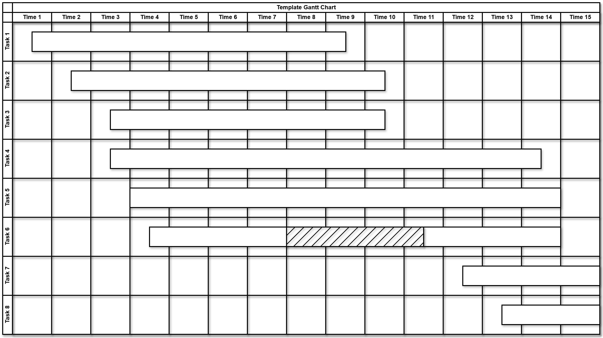
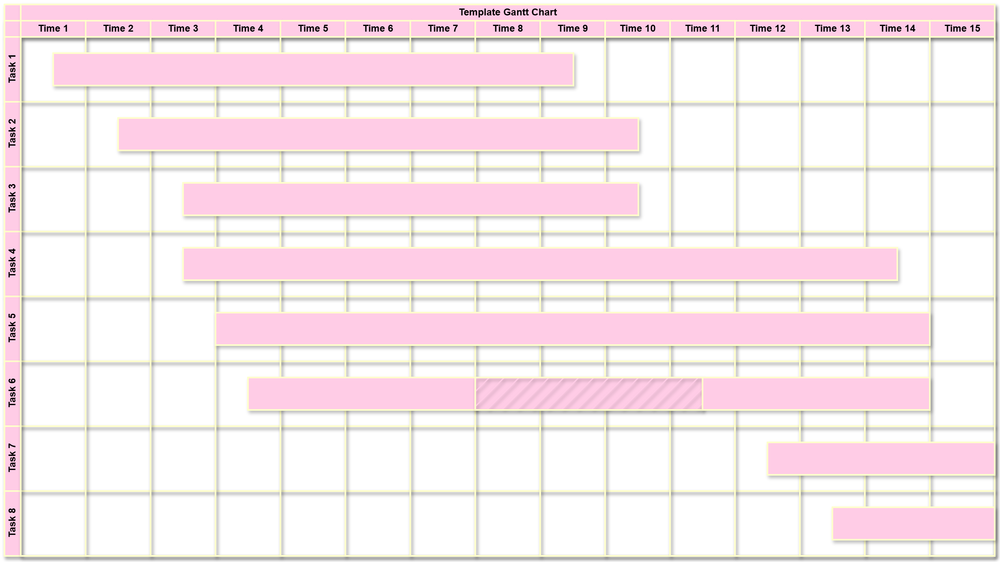
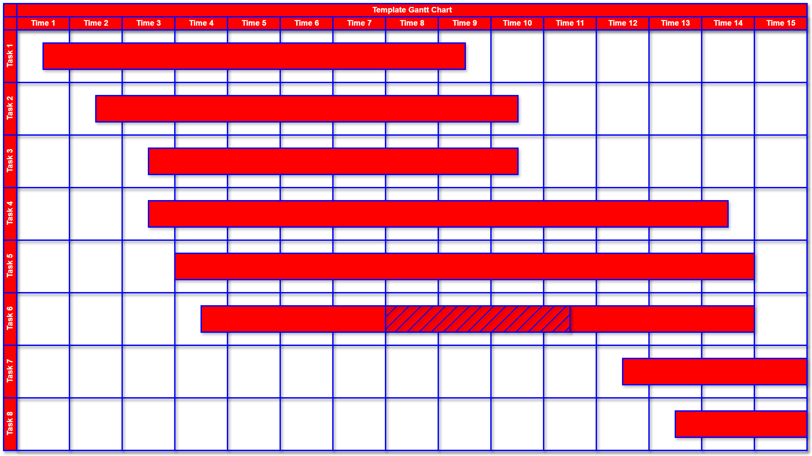
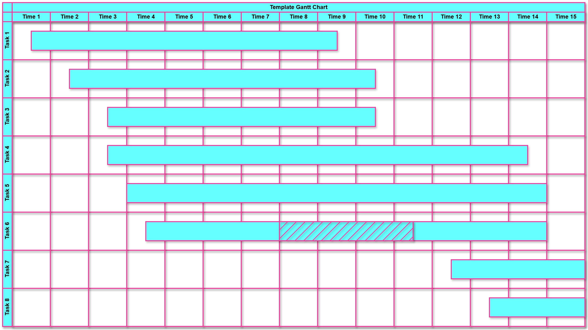
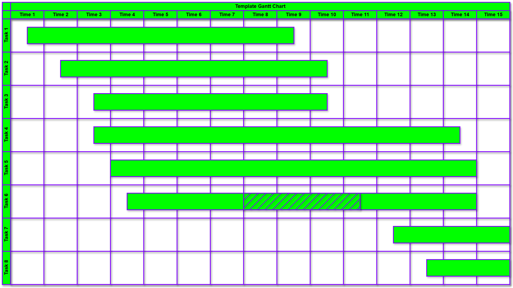

# drawio-templates

Reusable [draw.io](https://app.diagrams.net/) templates for common diagrams.

## Available Templates

### Gantt Chart

Source: [`gantt-chart/gantt-chart.drawio`](gantt-chart/gantt-chart.drawio)

| Theme | Preview |
|---|---|
| Bland |  |
| Rose |  |
| Bomb Pop |  |
| Cotton Candy |  |
| Hulk |  |

## Usage

1. Download the `.drawio` file from the template directory.
2. Open in [draw.io](https://app.diagrams.net/) (web or desktop).
3. Customize for your project.

## Contributing

See [CONTRIBUTING.md](CONTRIBUTING.md) for guidelines.

## License

[MIT](LICENSE)
